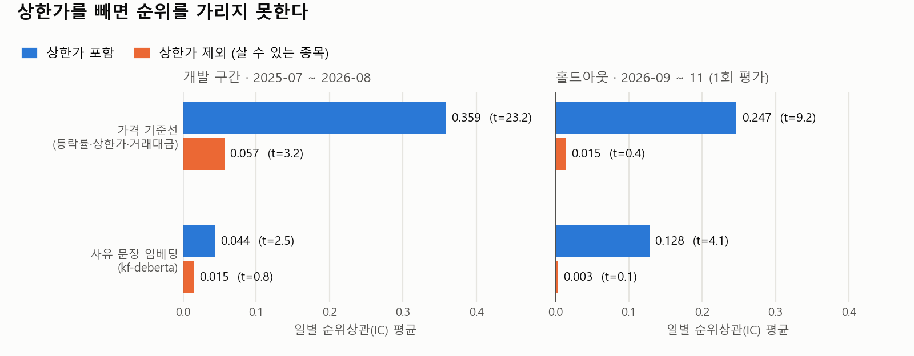
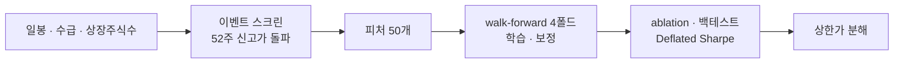
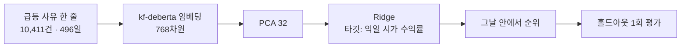

# 한국 급등주의 익일 초과수익 검증

> 52주 신고가를 돌파한 종목, 그날 급등한 종목을 **종가에 사서 다음 날 시가에 팔면** 돈이 남는가.
> 가격 모델과 한국어 금융 언어모델 두 가지로 검증했고, 결론은 둘 다 음성입니다.

**이 저장소가 보여주는 것은 수익 전략이 아니라, 그럴듯한 백테스트 수치가 어디서 무너지는지
찾아가는 검증 과정입니다.** 성과처럼 보인 것의 대부분은 종가에 살 수 없는 상한가 종목에서 나왔습니다.

| | |
|---|---|
| 대상 | 코스피·코스닥, 2020-01 ~ 2026-11 |
| 전략 | 당일 종가 매수 → 익일 시가 매도, 왕복비용 0.21% |
| 방법 | 확장형 walk-forward · 누수 통제 · 다중검정 보정 · 사전등록 홀드아웃 |
| 모델 | ExtraTrees·LightGBM 등 10종(가격), `kf-deberta` 임베딩 + Ridge(텍스트) |
| 테스트 | pytest 219건 |

## 목차

- [핵심 결과](#핵심-결과)
- [1부 · 가격 모델: 52주 신고가 돌파](#1부--가격-모델-52주-신고가-돌파)
- [2부 · 텍스트 모델: 급등 사유로 순위 매기기](#2부--텍스트-모델-급등-사유로-순위-매기기)
- [검증에서 지킨 것](#검증에서-지킨-것)
- [한계](#한계)
- [저장소 구조](#저장소-구조)
- [실행](#실행)
- [문서](#문서)

## 핵심 결과



1. **모델은 '상한가 탐지기'였다.** 가격 모델이 고른 종목의 74%가 상한가였습니다. 상한가는
   종가 단일가에서 매수 잔량만 쌓여 살 수 없습니다.
2. **상한가를 빼면 우위가 사라진다.** 가격 모델은 Welch p=0.27, 텍스트 모델은 홀드아웃
   순위상관 0.003(t=0.09)으로 둘 다 0과 구분되지 않았습니다.
3. **텍스트가 맞힌 것은 재료가 아니라 상한가 여부였다.** 급등 사유 문장에 "상한가"라는
   단어가 그대로 들어 있었습니다(상한가 종목의 98.5%).
4. **표준처럼 보이는 관행이 결과를 부풀리고 있었다.** 확률 보정을 학습 예측에 적합하면
   과신이 커지고, 셔플 K-fold는 walk-forward보다 AUC를 0.036 부풀렸습니다.
5. **모델 선택보다 문제 정의가 중요했다.** 모델 10종의 AUC 차이는 0.04 안쪽이었지만,
   실현할 수 없는 라벨("20일 내 최고 수익률") 하나가 결론을 뒤집었습니다.

## 1부 · 가격 모델: 52주 신고가 돌파

52주 신고가 돌파 이벤트에 피처 50개(기술 · 오버나이트 · Alpha158 일부 · 재료 · 수급)를
붙이고 트리 모델로 익일 시가 수익률을 예측했습니다. 코드는 `surge_d1/`.



| 단계 | 이벤트 | 결과 |
|---|---|---|
| 구 정의 (종가 252봉 신고가 · 거래량 1.5배) | 23,654건 | 평균 +0.4747% (t=17.62). 시장 조정·비용 차감 후 +0.2388% (t=8.81) |
| 모델 픽 (보정확률 0.55 이상) | 1,179건 | 순이익 승률 69.7%. **그중 74%가 상한가** |
| 신 정의 (스크리너 실전 조건 · 상한가 제외) | 5,675건 | 평균 +0.066% (t=1.85). 모델 상위 승률 46.2% vs 기저 40.7%, **p=0.27** |

- 헤드라인 수익의 절반은 시장 전체의 오버나이트 상승이었습니다.
- t값은 이벤트 단위라 같은 날 몰린 이벤트의 상관을 반영하지 못합니다. 거래일 단위
  재계산이 남은 일입니다.
- 출발점이었던 스크리너 모델은 "20일 안의 최고 수익률"을 학습했습니다. AI 점수 상위 20%는
  20일 내 최고 수익이 13.5% → 18.8%로 높았지만, 20일 뒤 실제 수익은 2.65% → 2.22%로
  오히려 낮았습니다(p=0.84). 청산 규칙 4종을 바꿔도 같았습니다(`studies/`).

상세: [연구 리포트](docs/연구리포트.md) · [연구자 자유도 기록](docs/연구자_자유도_기록.md)

## 2부 · 텍스트 모델: 급등 사유로 순위 매기기

미국 어닝콜 팩터 연구의 구조를 한국 급등주에 옮겼습니다. 코드는 `reason_rank.py`.



| 표본 | 모형 | 개발 순위상관 (t) | 홀드아웃 순위상관 (t) |
|---|---|---|---|
| 상한가 제외 | 사유 문장 임베딩 | 0.015 (0.78) | **0.003 (0.09)** |
| 상한가 제외 | 가격 기준선 | 0.057 (3.16) | 0.015 (0.37) |
| 상한가 포함 | 사유 문장 임베딩 | 0.044 (2.52) | 0.128 (4.11) |
| 상한가 포함 | 가격 기준선 | 0.359 (23.23) | 0.247 (9.19) |

- 주 모형과 평가 방식을 커밋(`9953f6e`)으로 고정한 뒤 홀드아웃(2026-09 ~ 11, 55거래일)을
  한 번만 평가했습니다.
- 살 수 있는 종목 안에서는 임베딩이 순위를 가리지 못했습니다.
- 상한가를 포함하면 임베딩도 유의하지만, 등락률·상한가 여부만 쓴 기준선이 두 배 높고
  임베딩을 더해도 나아지지 않습니다(0.247 → 0.243).
- `kf-deberta`는 2023년 12월에 공개됐고 자료는 2024년 11월부터라, 언어모델이 미래를
  미리 알고 있을 걱정은 없습니다.

상세: [재료 순위 결과](docs/재료순위_결과.md)

## 검증에서 지킨 것

| 항목 | 방법 |
|---|---|
| 시간 순서 | 확장형 walk-forward, 학습과 검정 사이 간격 유지 |
| 미래정보 | 피처 · 차원축소 · 확률 보정 · 벌점 선택을 학습 구간 안에서만 적합 |
| 시가총액 | 시점 상장주식수로 계산 (현재 주식수를 과거에 적용하지 않음) |
| 유니버스 | KRX 분류로 ETF · ETN · 우선주 · 리츠 제외, 상장폐지 종목은 유지 |
| 기준선 | 모든 모델을 텍스트 없는 기준선 · 단일 지표 규칙과 나란히 비교 |
| 다중검정 | Benjamini-Hochberg 보정, Deflated Sharpe Ratio |
| 연구자 자유도 | 데이터를 본 뒤 내린 결정 7건과 각각의 영향을 문서로 기록 |
| 홀드아웃 | 모형을 커밋으로 고정한 뒤 한 번만 평가 |

## 한계

- **체결을 재현하지 못합니다.** 일봉만 쓰므로 종가·시가 단일가에서의 체결 가능성과 가격
  충격을 잴 수 없습니다. 이를 재려고 호가 스냅샷을 2026-11-25부터 쌓고 있습니다.
- **가격 모델의 최종 홀드아웃은 아직 평가 전입니다.** 네 폴드는 버그를 고치며 여러 번
  봤습니다. 2026-08-28 ~ 2027-02-26 구간을 한 번만 평가하도록 [사전등록](docs/사전등록_홀드아웃.md)해 두었습니다.
- **사유 문장은 장 마감 뒤에 쓰인 한 줄 요약입니다.** 종가 매수에 쓰려면 장중에 같은
  내용을 알 수 있다고 가정해야 하고, 문장의 정보량도 적습니다.
- **텍스트 홀드아웃은 55거래일입니다.** 순위상관 0.07보다 작은 효과는 이 길이로 확인할 수
  없습니다.
- 기대값이 연도에 따라 크게 달라집니다.

## 저장소 구조

```
surge_d1/                가격 모델 패키지
  events.py              이벤트 정의 · 라벨
  features_f1~f6.py      피처 50개
  dataset.py             데이터셋 조립
  models.py              walk-forward 학습 · out-of-fold 보정 · ablation
  validate.py            지표 · 통계검정
  backtest.py            일별 백테스트 · Deflated Sharpe
  report.py              리포트 · 그림 생성
predict.py               오늘자 돌파 종목 점수 CLI
reason_rank.py           텍스트 모델: 임베딩 → Ridge → 일별 순위
scripts/                 자료 수집 · 조립 · 그림
studies/                 한 번 쓰는 검증 스크립트 (모델 비교 · 변수 검증 · 청산 규칙)
tests/                   pytest 219건
docs/                    연구 리포트 · 결과 · 사전등록 · 설계
deck/                    발표 자료
outputs/                 결과 표 · 그림
```

## 실행

```bash
pip install -r requirements.txt
pytest                              # 합성 데이터로 도는 단위 테스트 (외부 자료 불필요)
```

<details>
<summary>분석 파이프라인 (로컬 자료 필요)</summary>

```bash
# 1부 · 가격 모델
python -m surge_d1.dataset          # 이벤트 · 피처 · 라벨 조립
python -m surge_d1.models           # ablation · 누수 비교
python -m surge_d1.backtest         # 백테스트
python -m surge_d1.report           # 리포트 · 그림
python predict.py --asof 20260828   # 오늘자 돌파 종목 점수

# 2부 · 텍스트 모델
python scripts/parse_tg_reasons.py  # 텔레그램 급등 사유 → 표
python scripts/build_reason_panel.py
python reason_rank.py               # 개발 구간
python reason_rank.py --holdout     # 홀드아웃
python scripts/plot_reason_rank.py

# 검증 스크립트
python -m studies.model_compare
python -m studies.feature_study
```

일봉 캐시, 수급(키움 REST), 상장주식수(KRX), 급등 사유 텍스트는 **저장소에 포함하지
않았습니다.** 수집 스크립트는 `scripts/`에 있고 API 키는 각자 발급해야 합니다.
급등 사유 문장은 유료 구독 서비스와 공개 텔레그램 채널에서 본 것이라 원문을 다시 배포하지
않고, 집계 결과만 `outputs/`에 둡니다. 자료 위치는 `local_paths.example.json`을
`local_paths.json`으로 복사해 각자 PC에 맞게 적습니다.

</details>

## 문서

| 문서 | 내용 |
|---|---|
| [연구 리포트](docs/연구리포트.md) | 가격 모델 전체 결과 (구 정의 기준) |
| [재료 순위 결과](docs/재료순위_결과.md) | 텍스트 모델 개발 · 홀드아웃 결과와 한계 |
| [연구자 자유도 기록](docs/연구자_자유도_기록.md) | 데이터를 본 뒤 내린 결정과 각각이 결과를 움직인 정도 |
| [사전등록](docs/사전등록_홀드아웃.md) | 가격 모델 홀드아웃의 고정 기준 |
| [설계](docs/design/설계.md) · [구현 계획](docs/design/구현계획.md) | 처음 세운 설계와 작업 계획 |
| [발표 자료](deck/) | FIND-A 개인발표 PDF · 대본 |

## 참고 문헌

- George & Hwang (2004), *The 52-Week High and Momentum Investing*, Journal of Finance
- Lou, Polk & Skouras (2019), *A tug of war: Overnight versus intraday expected returns*, JFE
- Chen, Gao, He, Jiang & Xiong (2019), *Daily price limits and destructive market behavior*, Journal of Econometrics
- Seasholes & Wu (2007), *Predictable behavior, profits, and attention*, Journal of Empirical Finance
- Bailey & López de Prado (2014), *The Deflated Sharpe Ratio*, Journal of Portfolio Management
- Harvey & Liu (2015), *Backtesting*, Journal of Portfolio Management
- He, Lv, Manela & Wu (2025), *Chronologically Consistent Large Language Models*, arXiv:2502.21206

---

연구·학습 목적의 저장소이며 투자 권유가 아닙니다.
