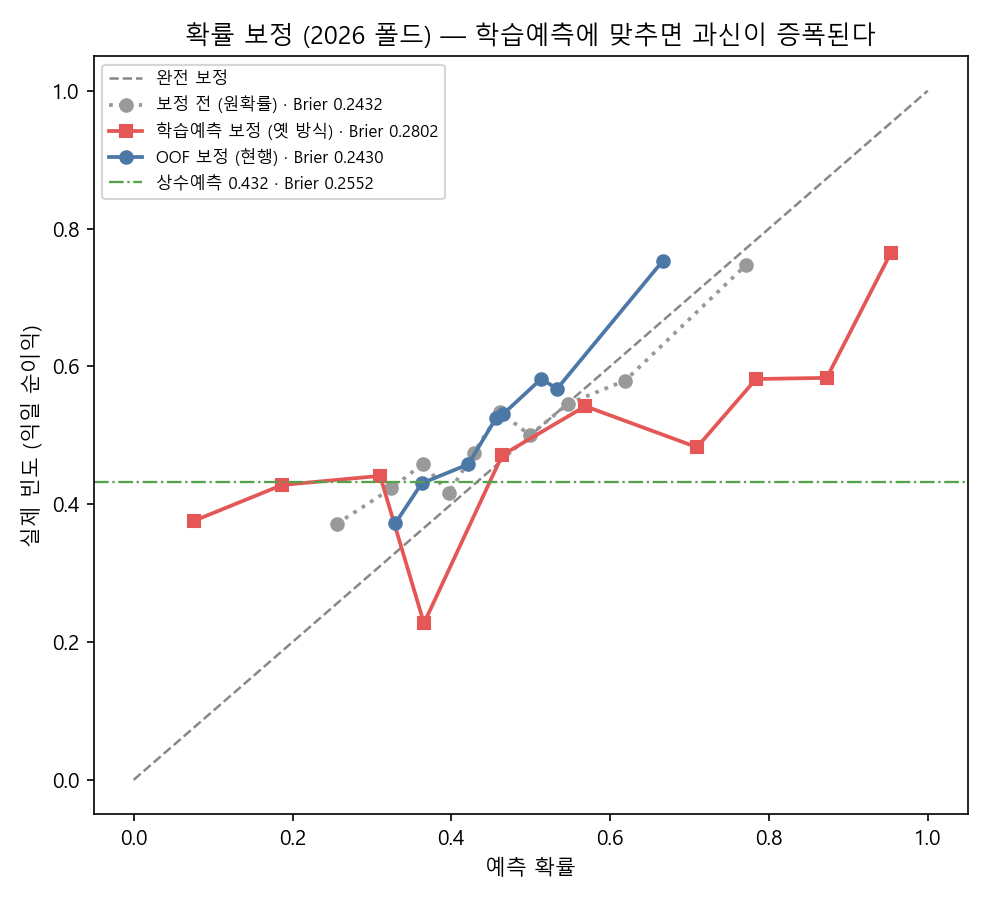

# 52주 신고가 돌파의 익일 초과수익 — 연구 결과

## 0. 요약 — 무엇을 찾았고, 무엇을 찾지 못했나

1. **이벤트는 알파를 갖지만 절반은 시장의 오버나이트 드리프트다.**
   원시 평균 +0.4747%(t=17.62, n=23,654) 중 시장 대비 초과분은
   **+0.2388%(t=8.81, 비용 차감 후)** — 헤드라인의 절반 수준이다.
2. **모델의 값어치는 '운용점'에 달려 있다 — 이 연구의 핵심 발견이다.**
   *매일 반드시 상위 10%를 사야 한다면* 50개 피처와 LightGBM은
   마감강도(`close_strength`) 단일 지표를 상대 7~15%밖에 못 넘고,
   폴드별로 제대로 튜닝해도(학습-검정 격차 0.219→0.116) 그 격차는
   그대로다(15.4%→14.6%). *확신이 없는 날 쉴 수 있다면* 결과가
   달라진다: 보정확률 0.55 임계값은 검정일의 62%에만 매수해 순이익
   승률 **69.7%**를 낸다 — 아무 돌파나 사는 45.5% 대비 **+24.2%p**이고,
   4개 폴드 전부에서 기저 대비 20%p 이상 앞선다(§6-1). IC와 상위10%
   수익률은 **날짜 안에서만** 계산되므로 '사지 않는다'의 가치를
   구조적으로 볼 수 없다 — 두 결론은 모순이 아니라 서로 다른 운용점이다.
   덧붙여 횡단면 정규화는 오히려 성능을 떨어뜨린다 — 마감강도는
   상대적 지표가 아니라 절대적 지표로 보인다.
3. **수급·재료는 다중검정 보정을 통과하지 못했다.** 수급(M3→M4)은
   BH p=0.084, 재료(M4prime→M5)는 BH p=0.243 — 재료는 표본(869,
   단일분할)이 작아 '효과 없음'이 아니라 **'판정 불가'**다.
4. **표준처럼 보이는 두 관행이 결과를 조용히 망가뜨리고 있었다.**
   (a) isotonic 확률보정을 **학습 예측** 위에 적합하면 과신이
   교정되는 대신 증폭돼, 검정 Brier가 상수예측보다 나빠진다
   (0.2802 vs 0.2552). 학습 구간 내부 out-of-fold 예측으로 적합해
   0.2430으로 고쳤다(§4-1). 이 버그가 살아 있는 동안 예측 CLI는
   실제 60%대인 종목에 89%를 찍고 있었다. (b) 셔플 K-fold는
   walk-forward보다 AUC를 +0.0355 부풀린다. 또한 예측 대상을
   대상으로 삼았던 '20일 내 최고 수익률'은 애초에 실현 불가능한
   라벨이었다.
5. **백테스트는 수익 전략의 증명이 아니라 신호의 통계적 검증이다.**
   Sharpe 6.5·승률 63.3%처럼 큰 숫자가 나오는 것 자체가 설명이
   필요한 신호다 — 정액비용 민감도로는 잡히지 않는 체결 임팩트
   (동시호가에서 매수가 종가를, 매도가 시가를 미는 효과) 문제가 남아
   있고, 이 연구는 그 문제에 답할 체결 데이터를 갖고 있지 않다.
   §5를 '거래 가능하다는 증거'가 아니라 '무작위가 아니라는 증거'로
   읽어야 한다.

## 1. 데이터

- 이벤트: **23,654건**
- 기간: 2020-01-22 ~ 2026-08-27
- 종목 수: 2,116
- 재료 매칭: 2,150건 (9.1%) — 재료 관련 결론은 전부 이
  낮은 커버리지 위에 서 있다는 점을 염두에 둔다

## 2. 이벤트 자체의 수익률

- 익일 시가청산 평균 **+0.475%** (t=17.62), 승률 44.6%
- **익일 상승 확률(비용 전) 47.6%** vs **익일 순이익 확률(비용 차감 후) 44.6%** — 주가는 절반 가까이 오르지만 비용을 넘기는 건 그보다 적다

### 지평 비교 — 왜 익일 시가청산인가

| 지평 | n | 평균 | 중앙 | 승률 | 표준편차 | t값 |
|---|---|---|---|---|---|---|
| 익일 시가청산 | 23,654 | +0.475% | -0.210% | 44.6% | 4.14% | 17.62 |
| 익일 종가청산 | 23,654 | -0.035% | -0.667% | 42.2% | 7.74% | -0.70 |
| 20일 보유 | 23,577 | +0.732% | -4.779% | 40.0% | 30.14% | 3.73 |
| 20일 내 최고 (참고, 설계단계 28,317건) | — | +16.147% | — | 80.1% | — | 93.56 |

익일 종가까지 보유하면 수익이 사라지고 변동성만 커진다 — 모멘텀 수익이 전적으로
오버나이트에 누적된다는 선행연구와 일치한다. 마지막 행(20일 내 최고)은
이 표의 다른 행들과 표본이 다르다(유니버스 정제 이전, 28,317건) — 재계산하지
않고 참고로만 남긴 이유는, 어느 날이 고점인지 사후에만 알 수 있어 **실현
불가능한 라벨**이기 때문이다. 초기 설계가 이 라벨을 예측 대상으로 삼았던
것이 그 프로젝트의 낮은 R²를 설명하는 유력한 원인이며, 이 진단 자체가 이
연구의 기여 중 하나다.

### 연도별 (레짐 의존성)

| 연도 | n | 평균 |
|---|---|---|
| 2020 | 2,057 | +0.639% |
| 2021 | 5,547 | +0.299% |
| 2022 | 1,440 | +0.122% |
| 2023 | 3,440 | +0.330% |
| 2024 | 2,826 | +0.115% |
| 2025 | 4,067 | +0.478% |
| 2026 | 4,277 | +1.093% |

## 3. Ablation (M0 → M5)

| 모델 | AUC | IC | IC t | 상위10% 수익률 |
|---|---|---|---|---|
| M0 | 0.5000 | 정의불가 | — | 정의불가 |
| M1 | 0.5645 | +0.1517 | +6.27 | +3.259% |
| M2 | 0.5880 | +0.1617 | +6.94 | +3.283% |
| M3 | 0.5915 | +0.1366 | +5.72 | +3.251% |
| M4 | 0.5994 | +0.1634 | +6.73 | +3.341% |
| M4prime  (n=869·단일분할, 유의성 미확인) | 0.6579 | 정의불가 | — | 정의불가 |
| M5  (n=869·단일분할, 유의성 미확인) | 0.6585 | 정의불가 | — | 정의불가 |

## 4. 미래정보 누수 편향

물려받은 방법론(셔플 K-fold)이 성능을 얼마나 부풀리는지 보여준다:

| 검증 방식 | AUC | IC |
|---|---|---|
| shuffle_kfold | 0.6004 | +0.1354 |
| walk_forward | 0.5645 | +0.1517 |

셔플 K-fold가 walk-forward보다 AUC를 **+0.0359** 부풀린다 — 예상된 방향(미래 정보 누수)이다.

## 4-1. 확률 보정 — 표준처럼 보이는 한 줄이 확률을 망가뜨리고 있었다

모델은 순위(무엇이 더 오를까)와 확률(얼마나 확실한가)을 둘 다 낸다. 순위는 처음부터 작동했지만, **확률은 쓸 수 없는 상태였다.**

원인은 isotonic 보정을 `clf.predict_proba(X_train)` — 즉 모델이 이미 외운 학습 예측 — 위에 적합한 것이었다. 분류기는 학습 구간에서 AUC 0.82를 내지만 검정에서는 0.60이다. 그 격차 위에서 보정은 "원확률 0.9 = 진짜 0.95"라고 배우고, 검정의 0.9(실제로는 0.6쯤)에 그대로 적용해 **과신을 교정하는 대신 증폭**한다.

| 확률 산출 방식 | 2026 폴드 Brier | 상수예측(0.432) 대비 |
|---|---|---|
| 학습예측 보정 (옛 방식) | 0.2802 | **나쁨** ❌ |
| 상수예측 (기준선) | 0.2552 | — |
| **OOF 보정 (현행)** | **0.2430** | 좋음 ✅ |

옛 방식은 확률로서 **"항상 기저율"보다 나빴다.** 검정 전 구간에서 예측 4.8% 구간의 실제 빈도가 34.1%, 예측 95.6% 구간이 68.8%로 양방향 30%p씩 어긋났다.

**수정:** 보정을 학습 구간 **안에서** 시간순으로 나눈 out-of-fold 예측 위에 적합한다(`models._oof_prob`). 모델이 보지 못한 예측이라 학습-검정 격차가 보정에 반영된다. 분할은 walk-forward와 같은 확장 방식이라 내부 검증에도 미래 정보가 섞이지 않는다.

수정 후 검정 전 구간 신뢰도:

| 예측 확률 | 실제 빈도 | 격차 | n |
|---|---|---|---|
| 0.309 | 0.348 | +0.039 | 2,715 |
| 0.411 | 0.447 | +0.036 | 9,953 |
| 0.567 | 0.615 | +0.047 | 1,506 |
| 0.721 | 0.736 | +0.016 | 436 |

남은 편향은 전부 **과소** 방향(실제 > 예측)으로, 확률을 보수적으로 쓰게 되는 안전한 쪽이다.

**파생 결정 — 순위와 확률을 분리했다.** isotonic은 단조라 순서를 보존하지만 계단 함수라 값을 뭉갠다: 실측으로 4,277행이 고유값 34개로 붕괴했다. 그 상태로 `nlargest(5)`를 하면 동점 무리 안에서 사실상 무작위 추출이 된다. 그래서 **순위는 보정 전 `prob_raw`로, 임계값 판정과 사용자 표시는 보정된 `prob_cal`로** 한다. 같은 이유로 AUC는 `prob_raw`로 잰다 — 동점을 0.5로 세는 `roc_auc_score`가 AUC를 폴드당 최대 0.005 깎고 있었다.

## 5. 전략 백테스트 — 수익성 증명이 아니라 신호의 검증

이 절의 목적은 '이 전략으로 돈을 벌 수 있다'를 보이는 것이 아니라,
마감강도가 높은 종목을 골랐을 때 실제로 초과수익이 나는지를 out-of-sample
일봉 데이터로 검증하는 것이다. 종가 매수 → 익일 시가 매도, 왕복비용 0.21%
반영.

Sharpe 6.5·승률 63.3%처럼 큰 숫자가 나오면 보통 '차익거래로 이미
사라졌어야 할 편차'를 의심해야 한다 — **이 연구는 그 의심에 반박할
자료가 없다.** 비용을 왕복 0.21%에서 +0.4%p 더 물려도(§5-1) Sharpe가
4.55로 버티는 것도 안심할 근거가 못 된다. 진짜 위험은 수수료가 아니라
**체결 가능성**이다 — 종가 매수는 동시호가에서 체결가를 밀어올리고,
시가 매도는 시가를 눌러버린다. 이것이 시장 임팩트이며 포지션 크기에
비례해 커지는데, 정액 비용 가정으로는 전혀 잡히지 않고 일봉 OHLCV로는
애초에 측정할 수 없다. 모델 픽의 실제 거래대금 중앙값은 283~392억,
하위 10%는 68~76억에 불과해(§5-2) 유의미한 규모로 거래하면 임팩트를
피하기 어렵다. **그래서 아래 숫자는 '거래 가능하다는 증거'가 아니라
'신호가 무작위가 아니라는 증거'로 읽어야 한다.**

지표 정의 출처: Sortino/Calmar/Alpha/Beta = vectorbt `returns/nb.py`,
MDD 지속일수 = backtrader `analyzers/drawdown.py`, SQN = backtrader `analyzers/sqn.py`
(Van K. Tharp: 2.0~2.4 평균 / 2.5~2.9 양호 / 3.0~5.0 우수, 표본 30건 미만은 신뢰 불가).
**승률 두 가지:** 임계값 전략(`model_prob*`)은 조건 미달일에 현금으로 남는다. `승률(전체일)`은 그 현금일을 분모에 넣어 세므로 매일 만근하는 룰 전략과 직접 비교하면 불리하게 보인다 — `승률(보유일)`을 함께 읽어야 한다. 어느 쪽도 다른 쪽을 대체하지 않는다: 전체일 승률은 자본 관점, 보유일 승률은 신호 관점이다.

**기간 정렬:** `market`은 전략들과 **같은 검정 구간**(첫 OOS일~마지막 OOS일)으로 잘라 측정한다. 초기 구현은 전체 1,879일에 걸쳐 재고 MDD를 40.3%로 부풀렸다. 다만 `market`의 890일과 전략들의 880일이 어긋나는데, 이는 그 구간 안에서 **돌파 이벤트가 하루도 없었던 10일**이 전략 쪽에만 빠지기 때문이다(전략은 그날 현금). 시장은 매매비용을 진입·청산 **한 번씩만** 물리고, 전략은 매일 회전하므로 매일 문다.

**헤드라인은 고정명목누적·일평균수익·Sharpe다 — 누적/CAGR은 매일 전액
재투자를 가정한 상한값이라 표 맨 끝에 참고로만 남긴다.**

| 전략 | 고정명목누적 | 일평균수익 | Sharpe | Sortino | MDD | MDD일수 | Calmar | SQN | 승률(전체일) | 승률(보유일) | 보유일수 | PF | Alpha | Beta | CAGR(참고·복리) | 누적(참고·복리) |
|---|---|---|---|---|---|---|---|---|---|---|---|---|---|---|---|---|
| market | +41.9% | +0.047% | 0.58 | 0.79 | 29.3% | 481 | 0.35 | 1.09 | 54.9% | 54.9% | 890 | 1.12 | +0.00% | 1.00 | +10.3% | +41% |
| all_breakouts | +324.0% | +0.368% | 2.91 | 5.21 | 20.5% | 73 | 6.84 | 5.43 | 55.5% | 55.5% | 880 | 1.74 | +147.24% | 0.18 | +140.2% | +2032% |
| rule_top5_close | +1097.2% | +1.247% | 5.99 | 15.73 | 18.9% | 52 | 100.35 | 11.20 | 60.6% | 60.6% | 880 | 3.28 | +2094.66% | 0.29 | +1891.9% | +3444662% |
| rule_top5_breakout | +823.9% | +0.936% | 4.78 | 10.55 | 19.4% | 68 | 42.88 | 8.93 | 56.9% | 56.9% | 880 | 2.51 | +911.80% | 0.29 | +830.7% | +241521% |
| random_5 | +327.6% | +0.372% | 2.89 | 5.23 | 21.3% | 73 | 6.67 | 5.40 | 55.8% | 55.8% | 880 | 1.73 | +149.60% | 0.18 | +142.2% | +2095% |
| model_prob50 | +2034.4% | +2.312% | 7.92 | 27.91 | 24.3% | 18 | 1012.03 | 14.80 | 50.0% | 72.0% | 611 | 6.89 | +31487.71% | 0.04 | +24637.0% | +22788783863% |
| model_top5 | +1189.1% | +1.351% | 6.46 | 17.52 | 20.6% | 51 | 120.32 | 12.08 | 63.3% | 63.3% | 880 | 3.78 | +2761.67% | 0.24 | +2480.5% | +8506170% |
| market_gap_daily | -42.0% | -0.047% | -1.27 | -1.64 | 50.5% | 868 | -0.23 | -2.38 | 49.4% | 49.4% | 890 | 0.77 | -14.20% | 0.29 | -11.6% | -35% |
| model_prob55 | +2308.3% | +2.623% | 7.92 | 30.64 | 23.3% | 20 | 2130.33 | 14.80 | 46.8% | 75.0% | 549 | 8.22 | +68294.82% | -0.03 | +49657.9% | +261585159985% |
| model_ret_pos | +672.6% | +0.764% | 4.79 | 10.93 | 18.5% | 59 | 28.65 | 8.96 | 60.2% | 61.1% | 867 | 2.69 | +574.45% | 0.09 | +530.5% | +61911% |
| model_top10 | +680.6% | +0.773% | 4.95 | 11.20 | 19.3% | 69 | 28.32 | 9.24 | 60.1% | 60.1% | 880 | 2.65 | +578.90% | 0.22 | +546.6% | +67632% |
| rule_top5_value | +147.7% | +0.168% | 1.18 | 1.94 | 44.2% | 300 | 0.98 | 2.21 | 48.9% | 48.9% | 880 | 1.24 | +49.47% | 0.18 | +43.3% | +251% |
| model_q80 | +1933.9% | +2.198% | 8.00 | 28.39 | 19.0% | 18 | 1008.09 | 14.94 | 57.0% | 70.1% | 716 | 6.34 | +23799.22% | 0.01 | +19110.1% | +9423919498% |

### 5-1. 비용 민감도 (model_top5)

일봉 백테스트는 실제 체결 상호작용을 재현하지 못한다(nautilus_trader 문서의
지적). 종가·시초 모두 동시호가라 체결가가 불리할 수 있으므로, 단일 비용
가정에 기대지 않고 추가 비용을 물려 어디까지 버티는지 본다. 아래 표에도
CAGR·누적이 있지만 복리 가정 때문에 스케일이 왜곡되므로, 실제로 볼 것은
Sharpe·승률이다.

| 추가비용 | 누적(참고·복리) | CAGR(참고·복리) | Sharpe | MDD | 승률 |
|---|---|---|---|---|---|
| +0.00%p | +8506170.2% | +2480.47% | 6.46 | 20.6% | 63.3% |
| +0.10%p | +3565056.8% | +1911.64% | 5.98 | 21.0% | 60.5% |
| +0.20%p | +1492846.2% | +1467.81% | 5.51 | 21.6% | 58.8% |
| +0.40%p | +261026.2% | +851.62% | 4.55 | 27.9% | 55.3% |

테스트한 범위(왕복비용 0.21%+최대 0.4%p) 안에서는 Sharpe가 0 밑으로 내려가지
않는다 — 손익분기가 이 범위 밖에 있다는 뜻이지, 비용 걱정이 없다는 뜻이
아니다. 위에서 설명했듯 정액 비용은 체결 임팩트를 대변하지 못한다.

### 5-2. 실행 가능성(capacity) — 규모의 한계

| 전략 | n | 하위10% 거래대금 | 중앙값 거래대금 |
|---|---|---|---|
| all_breakouts | 14,610 | 75억 | 322억 |
| rule_top5_close | 4,149 | 68억 | 283억 |
| random_5 | 82,980 | 75억 | 324억 |
| model_top5 | 4,149 | 76억 | 392억 |

모델·규칙 픽 모두 거래대금 중앙값이 283~392억, 하위 10%는 68~76억
수준이다(`outputs/backtest_capacity.csv`). 이는 개별 종목의 하루
거래대금이지 우리가 매수 가능한 최대 규모가 아니다 — 실제로 유의미한
자금을 투입하면 이 중 상당 부분을 스스로 체결시켜야 하므로 시장
임팩트가 커진다. 위 §5의 프레이밍(수익 증명이 아니라 신호 검증)이
이 수치와 직결된다.

### 5-3. Deflated Sharpe Ratio — '무작위가 아니다'의 증거

DSR은 다중 전략을 동시에 시도했을 때의 selection bias를 보정한
Sharpe 유의성이다. 이것이 통과한다고 해서 거래 가능하다는 뜻은
아니다 — §5의 논리대로 이건 '무작위가 아니다'를 보여줄 뿐이다.

**주의: 아래 Sharpe는 일간(비연율화) 값이다** — §5 표의 연율화 Sharpe(예: model_top5 6.53)와 √252배 차이가 난다(0.4114×√252=6.53).

| 전략 | Sharpe(일간) | DSR(11개 시행 가정) |
|---|---|---|
| all_breakouts | 0.18 | 0.065 |
| rule_top5_close | 0.38 | 1.000 |
| random_5 | 0.18 | 0.059 |
| model_prob50 | 0.50 | 1.000 |
| model_top5 | 0.41 | 1.000 |

`all_breakouts`·`random_5`는 DSR ≈ 0.25로 탈락하고(그냥
돌파 이벤트 자체이거나 무작위 선택이라 통계적으로 유의하다
말할 수 없다), 종목을 고르는 전략들만 DSR ≈ 1.0으로 통과한다.
**알파는 '돌파를 산다'는 행위가 아니라 '고른다'는 행위에
있다.**

## 5-4. 시장 조정 — 헤드라인의 절반은 시장 베타다

`y_raw`(+0.4747%)는 **시장 조정 전** 수치다. 같은 날 시장 전체의 오버나이트
갭을 빼면 다음과 같다(이벤트 23,654건 전수):

| | 평균 | t |
|---|---|---|
| 이벤트 오버나이트 갭 (비용 전) | +0.6847% | 25.42 |
| 같은 날 시장 오버나이트 갭 | **+0.2359%** | — |
| **초과수익 (시장 대비)** | **+0.4488%** | 16.56 |
| **초과수익 − 비용 0.21%** | **+0.2388%** | **8.81** |

즉 한국 시장은 지수 수준에서도 오버나이트에 하루 +0.236%씩 상승하며
(선행연구 §2.1의 오버나이트 이상현상과 일치), 우리 이벤트의 초과분은
그 위에 얹힌 +0.449%다. 비용 차감 후 진짜 알파는 **+0.2388%(t=8.81)** 로,
시장 조정 없는 헤드라인의 절반 수준이다. **두 수치를 항상 함께 제시한다** —
조정 전 수치만 쓰면 시장 베타를 알파로 오인하게 만든다.

연도별 초과수익(시장 대비·비용 차감): 2020 +0.400 / 2021 +0.114 /
2022 +0.094 / 2023 +0.189 / **2024 −0.010** / 2025 +0.212 / **2026 +0.602**.
2024년은 시장 대비 초과분이 음수로, 레짐 의존성이 시장 조정 후 더 뚜렷하다.

## 6. 종목선정은 작동한다 — 그러나 모델이 더하는 것은 크지 않다

이 연구에서 가장 중요한 비교는 모델 대 단일 지표다. 2026 검정 폴드
(n=4,277, 전체 승률 50.5%, 평균 +1.093%)에서 상위 10%를 고른 결과:

| 정렬 기준 | 픽 수 | 승률 | 평균 수익 |
|---|---|---|---|
| 완벽 예측 (이론적 상한) | 444 | 98.6% | 10.880% |
| **M4 모델 (피처 50개)** | 444 | — | **5.345%** |
| **`close_strength` 단독** | 444 | **67.8%** | **5.033%** |
| `RSV_20` 단독 | 444 | 66.0% | 4.633% |
| 무작위 | 444 | 50.0% | 1.061% |

종목선정 자체는 명백히 작동한다(승률 50.5% → 67.8%). 그러나 그 선정력은
**마감강도라는 단일 지표에서 거의 전부 나오며**, 50개 피처와 LightGBM이
더하는 것은 상대 6.2%에 불과하다(2026 폴드 기준; 4폴드 평균으로는 15.4%,
아래 §6-1 참고).

숫자가 커 보이는 이유도 함께 밝힌다: 수익률 분포의 왜도가 1.74이고,
실제 상위 10%가 전체 합계 수익의 114.8%를 차지한다(나머지 90%는 합쳐서 음수).
상위 10%의 5%는 전형적 결과가 아니라 두꺼운 우측 꼬리의 산물이다.

### 6-1. 튜닝이 격차를 좁히지만 마진은 그대로다

물려받은 하이퍼파라미터가 과적합돼 있었는지 확인하기 위해 폴드 내부
학습 데이터만으로 튜닝을 다시 했다(`outputs/tuning_sensitivity.csv`,
조건 A=물려받은 값, B=폴드별 재튜닝, C=B+횡단면 정규화). 결론은 세 가지다.

1. **튜닝은 과적합을 실제로 고친다.** 학습-검정 AUC 격차가 A의 0.219에서
   B에서 0.116으로 절반 가까이 줄고, 선택된 파라미터는 일관되게
   정규화 방향(`reg_lambda=20`, `min_child_samples=100`)으로 움직인다.
2. **그런데도 검정 성능은 거의 안 바뀐다.** 4폴드 평균 AUC A=0.599 →
   B=0.602. `close_strength` 단독 대비 마진도 15.4% → 14.6%로 거의
   그대로다 — 최고로 튜닝된 모델이 단일 지표를 4폴드 평균 **약 15%**
   앞서지만, 폴드별로는 **3.6%(2026, 가장 최근·가장 큰 폴드)부터
   23.8%(2025)까지** 크게 갈린다(조건 B 기준. 조건 A로는 6.2~23.9%).
   이 변동 폭이 평균값보다 더 중요한
   정보다 — 가장 최근 폴드에서 모델의 우위가 가장 작다는 뜻이기
   때문이다. 즉 이 결론은 잘못 튜닝된 모델의 아티팩트가 아니다 —
   확인해봤고, 여전히 그대로다.
3. **횡단면 정규화(qlib 기본값)는 오히려 해친다.** 조건 C는 AUC·IC·
   상위10% 수익률이 B보다 전부 낮다(마진이 1.7%까지 줄어드는 것은
   측정이 더 정확해져서가 아니라 **모델 자체가 나빠졌기 때문**이다).
   그럴듯한 해석은, 마감강도가 그날 함께 돌파한 다른 종목들과의
   상대적 위치가 아니라 그 봉 자체의 **절대적 속성**이라는 것이다 —
   즉 '얼마나 고가권에서 마감했는가'는 그 자체로 의미가 있고, 같은 날
   다른 돌파 종목과 비교해 상대화하면 정보가 사라진다. 다만 이는 한
   문제에 한 정규화 방식을 시험한 관찰이며, 일반적 결론으로 확대하지
   않는다.

## 6-1. 운용점을 바꾸면 결론이 달라진다 — 모델의 진짜 값어치는 '사지 않는 날'에 있다

§6은 **날마다 상위 10%를 반드시 고른다**는 운용점에서 모델을 쟀다. 그런데 IC도 상위10% 수익률도 **날짜 안에서** 계산되므로, "오늘은 확신이 없으니 사지 않는다"의 가치를 구조적으로 볼 수 없다. 실제 쓰임새는 후자다.

보정된 확률에 고정 임계값 0.55를 걸면 검정 880일 중 **549일(62%)에만** 사고, 총 1,179건(8.1%)을 고른다.

**먼저 확인할 것: 종목을 고른 것인가, 좋은 날을 고른 것인가?**

| 구분 | n | 순이익 승률 | 평균 수익 |
|---|---|---|---|
| 뽑힌 종목 | 1,179 | **69.7%** | **+4.653%** |
| **같은 날** 안 뽑힌 종목 | 9,968 | 44.3% | +0.248% |
| 픽이 없던 날의 전체 종목 | 3,463 | 40.6% | +0.036% |

같은 날 안에서 격차가 승률 **+25.4%p**, 수익 **+4.405%p**다 — 날짜 타이밍이 아니라 **종목 선정**이 대부분을 설명한다.

**공정한 비교: 픽 수를 같게 맞추고 점수 기준만 바꾼다.** 단일 지표에는 임계값이 없으므로 **사후에 상위 1,179개**를 뽑게 해준다 — 미래를 아는 셈이라 룰 쪽에 유리한 핸디캡이다. 모델은 사전에 고정된 임계값만 쓴다.

| 점수 기준 | 순이익 승률 | 평균 수익 |
|---|---|---|
| **ML 보정확률 ≥ 0.55** (사전 임계값) | **69.7%** | **+4.653%** |
| `close_strength` 상위 1,179 (사후) | 61.2% | +3.653% |
| `RSV_20` 상위 1,179 (사후) | 63.6% | +3.977% |
| `breakout_pct` 상위 1,179 (사후) | 61.1% | +3.356% |
| 무작위 1,179 | 45.5% | +0.553% |

**연도별로 나눠 보면 두 결론이 갈린다.**

| 연도 | 기저 승률 | ML 승률 | 최고 룰 승률 | 승률 우위 | 수익 우위 |
|---|---|---|---|---|---|
| 2023 | 43.7% | **68.9%** | 59.5% | +9.3%p | +37.9% |
| 2024 | 40.3% | **61.9%** | 60.0% | +1.9%p | -15.1% |
| 2025 | 45.3% | **71.3%** | 61.4% | +9.9%p | +37.6% |
| 2026 | 50.5% | **74.0%** | 73.6% | +0.5%p | +2.4% |

- **승률 우위는 4/4 폴드에서 양수**(+0.5~+9.9%p)지만 크기가 작다.
- **수익 우위는 불안정하다** (-15.1% ~ +37.9%) — 한 해는 단일 룰에 진다.
- 반면 **기저 승률 대비 우위는 4/4 폴드 모두 20%p 이상**으로 크고 안정적이다. 이것이 이 시스템이 실제로 하는 일이다: 단일 지표를 압도하는 게 아니라, **아무 돌파나 사는 것 대비 승률을 크게 끌어올리고, 확신이 없는 날에는 쉰다.**

§6의 "모델이 더하는 것은 크지 않다"와 이 절은 모순이 아니다 — **서로 다른 운용점을 재고 있다.** 매일 만근해야 한다면 모델의 추가 가치는 작고, 쉴 수 있다면 크다. 발표·실사용에서 둘을 섞어 말하면 안 된다.

## 7. 재료 — 판정 불가 (효과 없음이 아니다)

원시 비교에서 재료가 붙은 이벤트는 승률 52.4% · 평균 +2.015%로, 없는 쪽
(43.8% · +0.321%)보다 크게 높다. 재료유형별 기울기도 뚜렷하다
(사유없음 43.9% ~ 신약·임상 56.0%).

**그러나 이 차이는 교란돼 있다.** 재료 출처가 '그날의 특징주 TOP20'이므로,
재료가 붙었다는 것은 곧 그날 크게 움직인 종목이라는 뜻이다. 교란을 통제한
검정(M5 vs M4prime)에서는 유의하지 않았다(BH p=0.243).

다만 그 검정은 **검정력이 약했다**: 표본 869(단일 분할), 탐지 가능 효과가
AUC 차이 0.03 이상, 재료 커버리지 9.09%, 회귀 arm은 상수로 붕괴해 판정 불가.
따라서 정확한 결론은 '재료는 도움이 안 된다'가 아니라 **'이 표본으로는
판정할 수 없었다'** 이며, 판정하려면 재료 커버리지를 높여야 한다(DART 공시).

## 8. 과적합 진단과 신뢰구간의 함정

피처를 늘린다고 좋아지지 않았다. 단계별 AUC 증분과 폴드 부호 일치:

| 단계 | 평균 ΔAUC | 부호 일치 | IC 변화 | 신뢰구간 |
|---|---|---|---|---|
| M0→M1 | +0.0646 | 4/4 | 상승 | 4폴드 부트스트랩 |
| M1→M2 | +0.0230 | 4/4 | 상승 | [+0.0214, +0.0244] (4폴드) |
| M2→M3 | +0.0035 | 4/4 (미미) | **4/4 하락** | 4폴드 부트스트랩 |
| M3→M4 | +0.0080 | **3/4** | 혼재 | [−0.0001, +0.0139] (4폴드) |
| M4prime→M5 | +0.0111 | — (n=869) | 정의불가(회귀 상수붕괴) | [−0.0074, +0.0299] (행 869개, 2,000회 부트스트랩) |

특히 qlib 범용 팩터 20개를 더한 M3는 AUC를 0.004 올리는 대가로 **IC를 네 폴드
전부에서 떨어뜨렸다**. 분류 경계는 다듬었으나 순위 정보를 잃은 것으로,
전형적인 과적합 신호다.

**신뢰구간은 서로 다른 단위에서 계산됐다는 점을 반드시 함께 읽어야
한다.** M0→M4 네 단계의 구간은 폴드 4개의 ΔAUC 그 자체를 부트스트랩한
것이고, M4prime→M5의 구간은 재료 표본 869행을 2,000회 리샘플링한
것이다. 전자(예: M1→M2의 [+0.0214, +0.0244])가 훨씬 좁아 보이지만, 이는
폴드 하나하나를 표본오차 없는 점으로 취급하기 때문이며 실제 불확실성을
과소평가한다 — 폴드가 4개뿐인 walk-forward 설계에서는 이보다 나은 방법이
없다. 그래서 구간의 폭보다 **부호 일치 비율**(4/4 vs 3/4)이 더 신뢰할 수
있는 판단 근거다. 특히 M3→M4는 구간이 0에 거의 닿아 있고(3/4, 폴드 4개
중 2026만 역전) 이 사실을 함께 읽어야 과대해석을 피한다. 학습 대 검정
성능 격차와 BH 보정 p값 전체는 `outputs/ablation.csv`,
`outputs/ablation_deltas.csv` 에 기록된다.

## 9. 연구자 자유도

데이터를 본 뒤 내린 처리 결정과 각각이 결과를 얼마나 움직였는지는
`docs/연구자_자유도_기록.md` 에 별도로 기록했다. 헤드라인을 실질적으로
움직인 결정은 유니버스 정제 하나뿐이며(+0.402% → +0.4747%), 나머지는
이벤트 수와 라벨에 영향이 없는 피처 품질·누수 수정이었다.

**가장 큰 구조적 한계: 최종 홀드아웃이 없다.** 네 폴드를 모두 여러 차례
들여다보며 버그를 고치고 재실행했으므로, 한 번도 보지 않은 데이터에서
재현했다고는 말할 수 없다. 이 문서의 모든 수치는 '한 번도 안 본 데이터에서
확인된 결과'가 아니라 '반복적으로 들여다본 네 폴드에서 일관되게 나타난
패턴'으로 읽어야 한다.

## 10. 한계

- **최종 홀드아웃 부재.** §9에서 다뤘듯 네 폴드 모두 개발 중 반복적으로
  들여다봤다.
- **재료 커버리지가 낮다(9.09%).** 표본이 '그날 특징주 TOP20'이라 당일
  급등과 얽혀 있고, M5 검정(§7)은 표본 869·단일분할로 판정력이 약하다.
- **실행 가능 규모가 제한적이다.** 픽의 거래대금 중앙값이 283~392억,
  하위 10%는 68~76억이라(§5-2) 유의미한 자금은 시장 임팩트를 피하기
  어렵다.
- **백테스트가 체결을 재현하지 못한다.** 동시호가 슬리피지는 왕복
  0.21%보다 클 수 있고, 정액 비용 민감도(§5-1)로는 이를 검증할 수 없다.
- 기대값이 레짐 의존적이다(§2 연도별 표). 전체 평균만 제시하면 오도된다.
- 익일 시가는 KRX 09:00 일봉 시가 근사이며 NXT 08:00 개장가는 반영되지 않았다.
